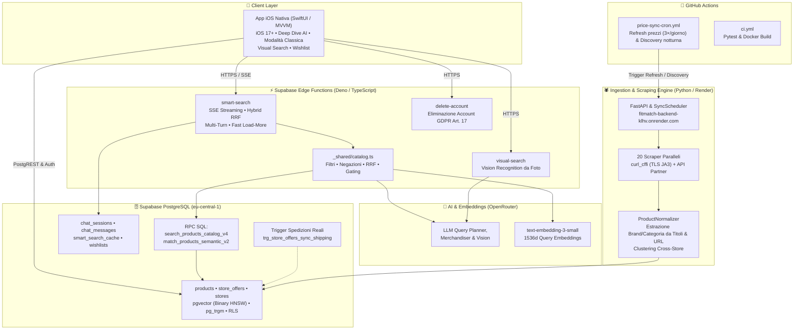

# 🏃 FitMatch — AI Sports Gear Price Comparator & Hybrid Search Platform


-3ECF8E?logo=supabase&logoColor=white)


**FitMatch** è una piattaforma end-to-end per la scoperta, la comparazione prezzi in tempo reale e la consulenza tecnica su scarpe da running, trail, abbigliamento tecnico, sportwatch GPS e attrezzatura sportiva nel mercato italiano ed europeo.

Combina un **motore di ricerca ibrido AI (`FTS + pgvector` con Reciprocal Rank Fusion)** su Supabase Edge Functions, una **pipeline di scraping e normalizzazione su 20 negozi partner** e un'**app iOS nativa in SwiftUI** con ricerca conversazionale Deep Dive, ricerca visiva da foto e monitoraggio cali di prezzo.

---

## 📊 Numeri Chiave del Catalogo

| Metrica | Stato Attuale |
| :--- | :--- |
| **Negozi partner integrati** | **20** retailer sportivi IT/EU |
| **Prodotti canonici indicizzati** | **38.800+** modelli sportivi unificati cross-store |
| **Offerte attive monitorate** | **61.000+** con taglie e costi di spedizione reali per store |
| **Copertura semantica vettoriale** | **37.700+** prodotti indicizzati con embedding HNSW binario (`pgvector`) |

---

## 🌐 Architettura di Produzione



---

## 🧠 Motore di Ricerca Ibrido & Suite AI

Tutte le funzionalità AI girano su **Supabase Edge Functions** a bassa latenza (`supabase/functions/`), condividendo la pipeline deterministica in [`_shared/catalog.ts`](supabase/functions/_shared/catalog.ts).

### 1. Ricerca Conversazionale & Ibrida (`smart-search`)
- **Hybrid Search parallela (`FTS + pgvector` + RRF)**: sulle query concettuali o per uso (es. *"Scarpe maratona"*, *"Giacca traspirante running"*, *"Scarpe comode per ginocchia sotto 150 euro"*) esegue in parallelo la ricerca lessicale (`search_products_catalog_v4`) e la ricerca vettoriale filtrata in SQL (`match_products_semantic_v2` su indice HNSW quantizzato binario), fondendo i ranking con **Reciprocal Rank Fusion (`k = 40`)**.
- **Filtri in linguaggio naturale (enforcement deterministico in SQL + guard finale)**:
  - Budget e fasce di prezzo: *"sotto i 150 euro"*, *"tra 80 e 120€"*, *"sopra i 200€"*.
  - Taglie normalizzate: EU/US/UK per scarpe (`36–49` incluse mezze taglie) e `XS–XXL` per abbigliamento.
  - Negazioni ed esclusioni: *"non Nike"*, *"escluso Tradeinn"*, *"senza piastra in carbonio"*, *"senza cappuccio"*, *"non impermeabile"*.
  - Ordinamenti e promo: *"le più economiche"*, *"sconti più alti"*, *"con spedizione gratuita"* (basata sulle soglie reali di spedizione per singolo store), *"su Cisalfa"*, colori.
  - Reset granulare: supporto per la rimozione di singoli filtri da chip (`✕`) o via testo (*"Rimuovi limite di prezzo"*, *"Rimuovi esclusioni"*, *"Tutte le taglie"*).
- **Memoria conversazionale multi-turn**: mantiene il contesto completo in `chat_sessions` / `chat_messages` senza perdere soggetto, brand o linea su follow-up come *"Da uomo"*, *"Sotto 120€"* o *"Qual è la più ammortizzata?"*.
- **Paginazione fast-path (`load_more: true`)**: in Modalità Classica carica pagine successive (`+30` prodotti disgiunti tramite `exclude_product_ids`) in ~1,4–2,2s saltando gli stadi LLM.
- **SSE Streaming & Cache server-side**: invia step di ragionamento in tempo reale all'app iOS e memorizza query standalone in `smart_search_cache` con TTL gestito.

### 2. Ricerca Visiva (`visual-search`)
- Riconosce scarpe, capi tecnici, sportwatch e accessori da foto o screenshot caricati dall'utente.
- Filtra contenuti non sportivi, identifica modello/brand/colore con livello di confidenza e alternative, e avvia una ricerca pulita nel catalogo verificato.

---

## 🎯 20 Negozi Partner Integrati

Tutti gli store includono **regole di spedizione reali** (costo standard, soglia spedizione gratuita e corriere) sincronizzate automaticamente dal trigger Postgres `trg_store_offers_sync_shipping` e da [`fitmatch/supabase_client.py`](fitmatch/supabase_client.py).

| # | Store | Dominio | Specializzazione | Integrazione |
| :-: | :--- | :--- | :--- | :--- |
| 1 | **Decathlon** | `decathlon.it` | Multisport globale & brand propri (Kiprun, Quechua, Van Rysel) | API / Web Scraper |
| 2 | **Cisalfa Sport** | `cisalfasport.it` | Retail sportivo #1 in Italia | Salesforce Commerce Cloud |
| 3 | **Maxi Sport** | `maxisport.com` | Running, sneaker & sportswear | Magento REST / Web |
| 4 | **Mister Running** | `misterrunning.com` | Specialista running & trail #1 in Italia | Clerk Search API |
| 5 | **Nencini Sport** | `nencinisport.it` | Catena multisport italiana | Session + GTM Parser |
| 6 | **Top4Running** | `top4running.it` | Specialista europeo running & gara | Luigi's Box AI Search |
| 7 | **Running Warehouse EU** | `runningwarehouse.eu` | Specialista running globale (EUR + IVA IT) | Catalogo GTM |
| 8 | **Deporvillage** | `deporvillage.it` | Ciclismo, outdoor, GPS & ottica sportiva | Algolia Fast Search |
| 9 | **Alltricks** | `alltricks.it` | Ciclismo, trail, caschi, GPS & nutrizione | Constructor.io API |
| 10 | **Sportler** | `sportler.com` | Outdoor, alpinismo, sci & running | FactFinder API |
| 11 | **Nike Ufficiale** | `nike.com/it` | Catalogo ufficiale Nike, ACG & Jordan | Official Store API |
| 12 | **Adidas Ufficiale** | `adidas.it` | Catalogo ufficiale Adizero, Terrex & Originals | Official Store API |
| 13 | **Tradeinn** | `tradeinn.com` | Runnerinn, Bikeinn, Trekkinn, Smashinn, Swiminn | Google Retail Search API |
| 14 | **DF Sport Specialist** | `df-sportspecialist.it` | Montagna, running, outdoor, padel & ciclismo | Shopify Storefront |
| 15 | **SportIT** | `sportit.com` | Calcio, padel, tennis, running, nuoto & sci | Shopify Storefront |
| 16 | **Tennis-Point** | `tennis-point.it` | Specialista europeo tennis & padel | Shopify Storefront |
| 17 | **Basketball Store** | `basketballstore.net` | Specialista basket & NBA | Shopify Storefront |
| 18 | **NonSoloSport** | `nonsolosport.it` | Multisport & footwear omnicanale | Shopify Storefront |
| 19 | **Intersport Italia** | `intersport.it` | Multisport, sci, calcio, running & ciclismo | Shopify Storefront |
| 20 | **Bshopzone** | `bshopzone.it` | Outdoor, arrampicata, trail & scialpinismo | Shopify Storefront |

---

## 📱 Applicazione iOS Nativa (`ios/FitMatch`)

Sviluppata in **SwiftUI** con architettura **MVVM**, **Swift Concurrency** (`async/await`) e caching immagini ad alte prestazioni:

- **Ricerca AI Deep Dive + Modalità Classica (`SearchView.swift`)**:
  - **Deep Dive AI**: cronologia conversazionale salvata su cloud, streaming live degli step di ricerca, sezioni curate per stile/utilizzo, schede spotlight, chip filtri interattive rimovibili (`✕`), suggerimenti di follow-up e **Visual Search** con fotocamera/libreria.
  - **Modalità Classica**: lista a card orizzontali allineate pixel-perfect con badge risparmio cross-store e spedizione gratuita, selettore taglie contestuale (scarpe `36–47` vs abbigliamento `XS–XXL`), foglio filtri avanzati (budget, store, spedizione gratuita, solo in sconto, ordinamento), autocomplete live dal catalogo e paginazione **"Carica altri prodotti"**.
- **Home, Scoperta & Store (`HomeView.swift`, `DealsView.swift`, `StoreDetailView.swift`)**: vetrina negozi partner, offerte del giorno con sconti verificati, brand seguiti e prodotti visti di recente.
- **Scheda Prodotto (`ProductDetailView.swift`)**: confronto trasparente di tutte le offerte attive ordinate per prezzo totale reale (prodotto + spedizione), disponibilità taglie e storico sconti.
- **Wishlist, Collezioni & Price Alert (`WishlistView.swift`, `PriceAlertSheet.swift`)**: collezioni personalizzate, monitoraggio cali di prezzo, notifiche e preferenze taglie in `AccountView.swift`.

---

## 🗂️ Struttura del Repository

```text
fitmatch/
├── supabase/
│   └── functions/
│       ├── _shared/
│       │   ├── catalog.ts          # Motore condiviso: filtri, negazioni, RRF, gating categorie, chat history
│       │   └── catalog_test.ts     # Test unitari Deno del motore di ricerca
│       ├── smart-search/index.ts   # Ricerca conversazionale Deep Dive, SSE, hybrid RRF & load_more
│       ├── delete-account/index.ts # Eliminazione definitiva account e dati (GDPR Art. 17)
│       └── visual-search/index.ts  # Riconoscimento prodotti sportivi da immagine
├── fitmatch/
│   ├── scrapers/                   # 20 scraper partner (registry.py, shopify_stores.py, store dedicati)
│   ├── matcher/normalizer.py       # Estrazione brand/categoria (titoli + URL), deduplica & clustering
│   ├── crawler.py                  # Crawler multi-store e orchestrazione indicizzazione
│   ├── supabase_client.py          # Client DB/upsert offerte con spedizioni reali
│   ├── models.py                   # Modelli Pydantic, taglie EU/US/UK e regole spedizione
│   ├── scheduler.py                # SyncScheduler autonomo per refresh prezzi & discovery
│   └── updater.py                  # Aggiornamento incrementale prezzi e disponibilità
├── ios/
│   ├── FitMatch.xcodeproj          # Progetto Xcode (rigenerabile con XcodeGen)
│   └── FitMatch/
│       ├── Models/                 # ProductModels.swift
│       ├── Services/               # APIService.swift, SupabaseManager.swift, Manager locali
│       ├── Components/             # SkeletonLoading.swift, componenti riutilizzabili
│       └── Views/                  # Home, Search, Deals, Wishlist, StoreDetail, Account
├── tests/                          # Suite pytest (test_normalizer.py, ecc.)
├── .github/workflows/              # ci.yml & price-sync-cron.yml
├── api.py                          # Server FastAPI (Render)
├── cli.py                          # CLI ricerca & worker locale
├── Dockerfile & render.yaml        # Deployment containerizzato
└── requirements.txt
```

---

## 🚀 Guida Sviluppatore

### 1. Requisiti
- **Python 3.11+** (crawler, normalizer e backend FastAPI)
- **Deno 2+** e **Supabase CLI** (sviluppo, test e deploy Edge Functions)
- **Xcode 16+** con iOS 17+ Simulator (e `xcodegen` opzionale per rigenerare `.xcodeproj`)

### 2. Variabili d'Ambiente
Configurare un file `.env` locale (non tracciato in git) e i secret di progetto su Supabase / Render:
- `SUPABASE_URL`, `SUPABASE_ANON_KEY`, `SUPABASE_SERVICE_ROLE_KEY`
- `OPENROUTER_API_KEY` (LLM + embeddings `text-embedding-3-small`)

### 3. Backend Python & CLI
```bash
# Installa dipendenze
pip install -r requirements.txt

# Avvia API FastAPI in locale (Swagger UI su http://127.0.0.1:8000/docs)
python3 -m uvicorn api:app --host 127.0.0.1 --port 8000 --reload

# Ricerca multi-store da terminale
python3 cli.py search "nike alphafly"
python3 cli.py search "garmin forerunner 265" --limit 5

# Avvio worker di sincronizzazione autonomo
python3 cli.py worker --immediate --refresh-hours 2
```

### 4. Supabase Edge Functions (Test, Check & Deploy)
```bash
# Test unitari e type-check TypeScript/Deno
deno test supabase/functions/_shared/catalog_test.ts
deno check supabase/functions/_shared/catalog.ts \
  supabase/functions/smart-search/index.ts \
  supabase/functions/visual-search/index.ts \
  supabase/functions/delete-account/index.ts

# Deploy in produzione su Supabase
supabase functions deploy smart-search visual-search delete-account \
  --project-ref <PROJECT_REF> --use-api
```

### 5. Build & Esecuzione App iOS
```bash
# Rigenera il progetto se aggiungi o sposti file Swift
cd ios && xcodegen generate

# Build per iOS Simulator
xcodebuild -project FitMatch.xcodeproj -scheme FitMatch \
  -sdk iphonesimulator -destination 'generic/platform=iOS Simulator' \
  CODE_SIGNING_ALLOWED=NO build
```

### 6. Suite di Test Automatizzati
```bash
# Test Python (normalizer, estrazione brand/categoria da URL, regole spedizione, clustering)
pytest -v

# Test Deno (filtri in query, negazioni, gating categorie, tokenizzazione)
deno test supabase/functions/_shared/catalog_test.ts
```

---

## ☁️ Infrastruttura Cloud & Automazione

| Componente | Provider / Regione | Ruolo |
| :--- | :--- | :--- |
| **Edge Functions & Search** | Supabase (`eu-central-1`) | `smart-search`, `visual-search`, `delete-account` |
| **Database & Vector Index** | Supabase PostgreSQL (`eu-central-1`) | `pgvector` (HNSW), `pg_trgm`, RPC `v4`/`v2`, RLS, trigger spedizioni |
| **Ingestion & Crawler API** | Render (Docker / Francoforte) | FastAPI + 20 scraper paralleli (`render.yaml`) |
| **LLM & Embeddings** | OpenRouter | Query planning, merchandising Deep Dive, Vision & `text-embedding-3-small` |
| **Cron & CI/CD** | GitHub Actions | `price-sync-cron.yml` (04:15 / 12:15 / 20:15 UTC) e `ci.yml` |

---

## 🔒 Sicurezza & Privacy
- **Row Level Security (RLS)** attivo sulle tabelle Supabase per isolare sessioni chat, wishlist, collezioni e avvisi di prezzo per utente/dispositivo.
- **Gestione Segreti**: nessuna credenziale o chiave API salvata nel codice sorgente; gestione tramite variabili d'ambiente, Render secrets e Supabase Vault.
- **TLS JA3 Fingerprinting**: utilizzo di `curl_cffi` nei crawler per ridurre i falsi blocchi anti-bot sulle richieste pubbliche di catalogo.
- **Conformità App Store**: flusso dedicato in app per la rimozione definitiva dell'account e dei dati cloud associati.
