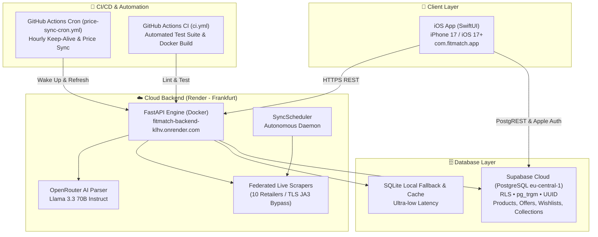

# 🏃 FitMatch — Cloud Sports Gear Price Comparator & Scraping Engine

Piattaforma end-to-end (Cloud Backend + Database PostgreSQL Enterprise + App Mobile iOS nativa in SwiftUI) per la comparazione prezzi in tempo reale, il monitoraggio sconti e la ricerca semantica con Intelligenza Artificiale nel mercato dell'abbigliamento, calzature e tecnologia sportiva.

---

## 🌐 Architettura di Produzione



---

## 🎯 14 Negozi Partner Integrati

1. **Decathlon** (`decathlon.it`): Leader globale retail sportivo e marketplace.
2. **Cisalfa Sport** (`cisalfasport.it`): Catena retail #1 in Italia (Salesforce Commerce Cloud).
3. **Maxi Sport** (`maxisport.com`): Grande specialista sneaker, running e sportswear (Magento REST API).
4. **Mister Running** (`misterrunning.com`): E-commerce specializzato #1 nella corsa in Italia (Clerk Fast Search API).
5. **Nencini Sport** (`nencinisport.it`): Catena sportiva multi-marca (Session warmup con CSRF e attributi GTM).
6. **Top4Running** (`top4running.it`): Gigante europeo nella corsa (Luigi's Box AI Search API).
7. **Running Warehouse Europe** (`runningwarehouse.eu`): Store globale leader nel running (Prezzi EUR con IVA italiana e catalogo GTM).
8. **Deporvillage** (`deporvillage.it`): Leader Sud Europa in outdoor, ciclismo, elettronica Garmin/Polar, occhiali Oakley (Algolia Fast Search).
9. **Alltricks** (`alltricks.it` — Gruppo Decathlon): Gigante europeo per ciclismo, trail, GPS, caschi e nutrizione (Constructor.io API).
10. **Sportler** (`sportler.com`): Leader del retail sportivo alpino e Nord Italia con 30+ megastore (FactFinder Suggest API e parsing GTM).
11. **Nike Ufficiale** (`nike.com/it`): Store ufficiale del brand #1 mondiale dello sport.
12. **Adidas Ufficiale** (`adidas.it`): Store ufficiale e catalogo Adizero / Terrex.
13. **Tradeinn** (`tradeinn.com` — Runnerinn, Bikeinn, Smashinn, Trekkinn): Gigante europeo con 3M+ articoli e Google Retail Search API.
14. **DF Sport Specialist** (`df-sportspecialist.it`): Storica catena italiana per running, montagna, outdoor, padel e ciclismo su piattaforma Shopify.

---

## 🧠 Ricerca Intelligente, Coach Biomeccanico & Confronto Modelli

Il motore intelligente implementa una suite di funzionalità AI avanzate per affiancare il podista e l'atleta:

1. **Confronto Modelli Head-to-Head (`/api/ai/compare`)**:
   - Mette a confronto diretto due modelli di scarpe o smartwatch (es. *Pegasus 41 vs Nimbus 26*, *Forerunner 165 vs 265*).
   - Analisi biomeccanica completa: drop (mm), peso (g), mescola dell'intersuola, presenza di piastra (carbonio/nylon), target podista e pro/contro tecnici.
   - Confronta i prezzi live nei 10 negozi, calcola il delta di prezzo e sintetizza il verdetto per valore e pura performance.

2. **Coach Biomeccanico IA (`/api/ai/advise`)**:
   - Analisi dei parametri fisiologici (peso corporeo, patologie come fascite plantare o tendiniti, superficie, budget, taglia).
   - Genera una diagnosi personalizzata del carico articolare ad ogni impatto e individua i modelli ottimali interrogando in tempo reale le offerte a stock.

3. **Comprensione Semantica con LLM (OpenRouter `meta-llama/llama-3.3-70b-instruct`)**:
   - Estrae intenzione d'acquisto, marca, categoria precisa (`running_shoes`, `gps_watch`, `eyewear`, `hydration`, `fitness`, `nutrition`, `gear`), budget massimo, taglia e caratteristiche tecniche (`carbon_plate`, `waterproof`, `trail`, `cushioning`).
   - **Fedeltà al modello**: Preserva rigorosamente modelli specifici (es. *"Nike alpha fly per la corsa"* ➔ `target_keywords: ["nike alphafly"]`, *"Forerunner 165"* ➔ `category: "gps_watch"`).
   - Fallback automatico su **Llama 3.1 8B Instruct** (400ms) e su `LocalHeuristicParser` in caso di offline.

4. **Live Multi-Store Federation Fallback**:
   - Se il database locale non ha ancora indicizzato il modello cercato, il backend attiva all'istante la federazione concorrente sui 10 negozi partner.
   - Raggruppa i risultati, normalizza i titoli, calcola i prezzi complessivi con spedizione e inserisce automaticamente i nuovi articoli nel database per le ricerche future.

---

## 📱 Applicazione iOS Nativa (`ios/FitMatch`)

Sviluppata interamente in **SwiftUI**, architettura **MVVM** e **Swift Concurrency**:

* **Schermata "Salvati" (Wishlist & Collezioni)**:
  - Header con avatar "L", barra a capsula e notifiche.
  - Selettore a pillole orizzontali (*Per te*, *Offerte*, *Segui già*, *Salvati*).
  - Card interattiva *"Collezioni >"* con pulsante "+ Crea collezione" e anteprima a mazzo di carte sovrapposte.
  - Griglia a 2 colonne con badge sconto in nero (es. `68% di sconto`), pulsante preferito viola e prezzi formattati.
* **Schermata di Ricerca Intelligente**:
  - Filtri dinamici tramite chip interattive generate dall'AI (marca, taglia, prezzo massimo, feature).
  - Mostra il risparmio cross-store (fino a 100€ di differenza per lo stesso modello tra negozi diversi).
* **Profilo & Cloud Monitor (`AccountView.swift`)**:
  - Indicatori di stato live per **Render Cloud Backend** e **Supabase Cloud Database**.
  - Sincronizzazione prezzi manuale con feedback aptico.
  - Gestione taglie preferite (scarpe 38–48 e abbigliamento XS–XXL).
  - Funzionalità conforme alle linee guida Apple per l'eliminazione definitiva dell'account e dei dati cloud.

---

## ☁️ Dettagli Infrastruttura Cloud

| Componente | Provider / Regione | Endpoint / URL | Note |
| :--- | :--- | :--- | :--- |
| **API & Scraper Engine** | Render (Docker / Francoforte) | `https://fitmatch-backend-klhv.onrender.com` | Blueprint gestito da `render.yaml` |
| **Database Principale** | Supabase (PostgreSQL / `eu-central-1`) | `https://goopfdvnqhdmsoutkldp.supabase.co` | RLS, estensioni `pg_trgm`, `uuid-ossp` |
| **AI LLM Engine** | OpenRouter | `https://openrouter.ai/api/v1` | `meta-llama/llama-3.3-70b-instruct` |
| **Keep-Alive & Cron** | GitHub Actions | `.github/workflows/price-sync-cron.yml` | Ping orario e refresh cali di prezzo |
| **CI / CD Pipeline** | GitHub Actions | `.github/workflows/ci.yml` | Test backend automatici e build Docker |

---

## 🚀 Utilizzo & Guida Sviluppatore

### 1. Requisiti
- Python 3.11+
- Xcode 16+ con iOS 17+ Simulator
- Docker (opzionale per container locale)

### 2. Avvio Locale del Backend
```bash
# Installa dipendenze
pip install -r requirements.txt

# Avvia server FastAPI con ricarica automatica
python3 -m uvicorn api:app --host 127.0.0.1 --port 8000 --reload
```
Swagger UI interattivo: `http://127.0.0.1:8000/docs`

### 3. Ricerca via CLI
```bash
# Ricerca multi-store con comparazione istantanea
python3 cli.py search "nike alphafly"
python3 cli.py search "garmin forerunner 165"
python3 cli.py search "asics nimbus 26" --limit 5

# Avvio worker di monitoraggio autonomo
python3 cli.py worker --immediate --refresh-hours 2
```

### 4. Compilazione & Esecuzione App iOS
```bash
# Rigenera il progetto Xcode con XcodeGen se aggiungi file
cd ios && xcodegen generate

# Compila ed esegui sul simulatore iOS
xcodebuild -project FitMatch.xcodeproj -scheme FitMatch -destination 'platform=iOS Simulator,name=iPhone 17' build
xcrun simctl install booted <path-to-app>
xcrun simctl launch booted com.fitmatch.app
```

### 5. Suite di Test Automatizzati
```bash
pytest -v
```
Verifica:
- Normalizzazione e disambiguazione entità (es. orologio vs custodia protettiva).
- Preservazione numeri di versione modello (*Pegasus 41* vs *Pegasus 42*).
- Guardrail contro anomalie e outlier di prezzo.
- Comprensione semantica dei modelli e categorizzazione smart search.

---

## 🔒 Sicurezza & Privacy
- **Row Level Security (RLS)** attivo su tutte le tabelle Supabase per isolare le collezioni e gli articoli salvati da ciascun utente.
- **TLS JA3 Fingerprinting**: Utilizzo di `curl_cffi` per evitare falsi positivi dei sistemi anti-bot Cloudflare/Akamai sui negozi online legittimi.
- Nessuna chiave API salvata in chiaro nel repository: gestione protetta tramite secret di ambiente (`render.yaml` e Supabase Vault).
